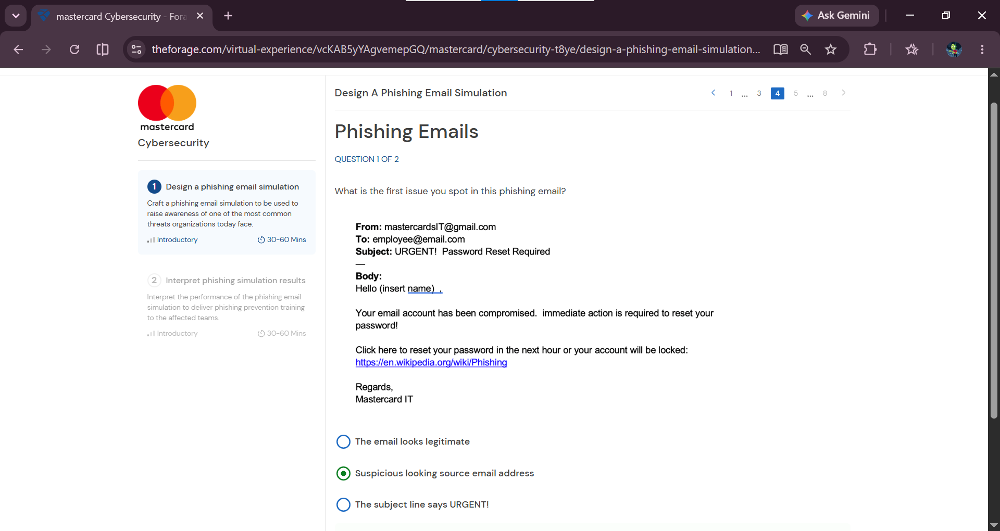
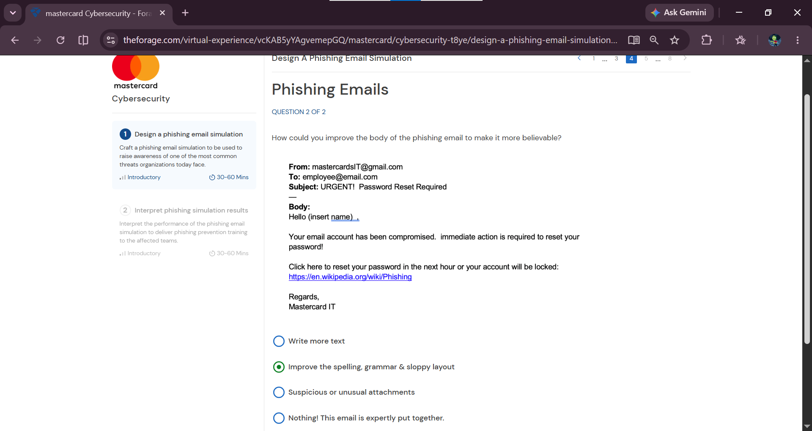
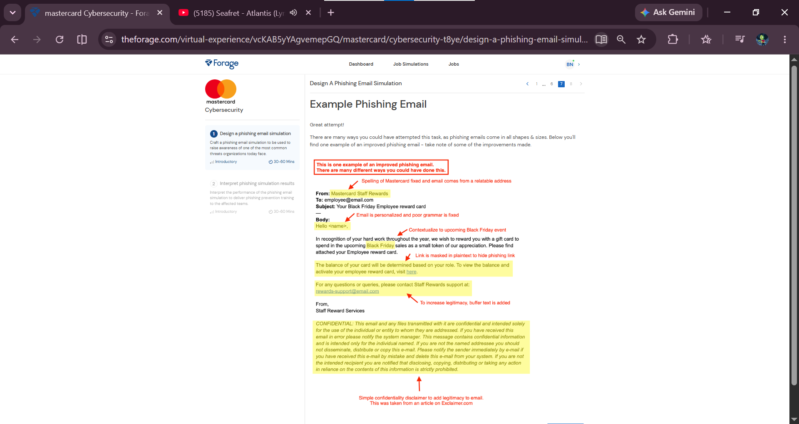
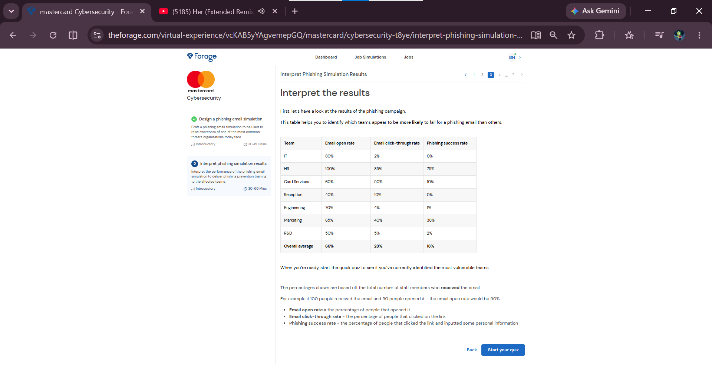

# Mastercard Job Simulation
22 November 2026 | 16:46
Forage - Mastercard Cybersecurity

## What is Phishing?

Phishing is the act of pretending to be someone / something to get information. In most cases, this is usually a password.

Think of it like fishing. The attacker throws out a fake email and waits for someone to bite.

---

## Task 1: Designing a Phishing Email Simulation

### The Bad Example

This is the first email from the simulation. It is easy to spot.

**From:** mastercardsIT@gmail.com
**To:** employee@email.com
**Subject:** URGENT! Password Reset Required

**Body:**
Hello (insert name),

Your email account has been compromised. immediate action is required to reset your password!

Click here to reset your password in the next hour or your account will be locked: https://en.wikipedia.org/wiki/Phishing

Regards,
Mastercard IT

### Question 1: What is the first issue you spot in this phishing email?

Answer: Suspicious looking source email address

Why:
- Mastercard would not use @gmail.com
- The name is also misspelled: mastercardsIT, not mastercard

### Question 2: How could you improve the body of the phishing email to make it more believable?

Answer: Improve the spelling, grammar and sloppy layout

Why:
- Bad spelling and bad grammar make people suspicious
- A clean email looks more real

### The Improved Example

**From:** Mastercard Staff Rewards
**To:** employee@email.com
**Subject:** Your Black Friday Employee reward card

**Body:**
Hello <name>,

In recognition of your hard work throughout the year, we wish to reward you with a gift card to spend in the upcoming Black Friday sales as a small token of our appreciation. Please find attached your Employee reward card.

The balance of your card will be determined based on your role. To view the balance and activate your employee reward card, visit here.

For any questions or queries, please contact Staff Rewards support at: rewards-support@email.com

From,
Staff Reward Services

CONFIDENTIAL: This email and any files transmitted with it are confidential...

### Why this improved email works better

- Spelling of Mastercard is fixed and email comes from a relatable address
- Email is personalized: Hello <name>
- It is contextualized to an upcoming event: Black Friday
- Link is masked in plaintext: it just says "here" to hide the phishing link
- Buffer text is added to increase legitimacy
- Simple confidentiality disclaimer is added to make it look official

Lesson: A good phishing email does not look like a scam. It looks normal, helpful, and timely.

---

## Task 2: Interpreting Phishing Reports

### The Results Table

| Team | Email open rate | Email click-through rate | Phishing success rate |
| :--- | :--- | :--- | :--- |
| IT | 80% | 2% | 0% |
| HR | 100% | 85% | 75% |
| Card Services | 60% | 50% | 10% |
| Reception | 40% | 10% | 0% |
| Engineering | 70% | 4% | 1% |
| Marketing | 65% | 40% | 38% |
| R&D | 50% | 5% | 2% |
| Overall average | 66% | 28% | 18% |

Percentages are based on the total number of staff who received the email.
For example, if 100 people received the email and 50 opened it, the open rate is 50%.

### What each rate means

- Email open rate = percentage of people that opened it
- Email click-through rate = percentage of people that clicked on the link
- Phishing success rate = percentage of people that clicked the link and inputted some personal information

### What the results show

**Most vulnerable: HR**
- 100% opened, 85% clicked, 75% gave info
- Highest success rate by far
- Needs training first

**Second most vulnerable: Marketing**
- 65% opened, 40% clicked, 38% gave info
- High click rate and high success rate

**Medium risk: Card Services**
- 60% opened, 50% clicked, but only 10% gave info
- They click a lot, but most stop before entering info
- Needs training on not clicking

**Low risk: IT, Engineering, Reception, R&D**
- IT: 80% opened, but 2% clicked, 0% gave info. They recognised it.
- Engineering: 70% opened, 4% clicked, 1% gave info
- Reception: 40% opened, 10% clicked, 0% gave info
- R&D: 50% opened, 5% clicked, 2% gave info

### Key lesson

Open rate alone does not mean vulnerable.

IT opened 80% but had 0% success. HR opened 100% and had 75% success.

The success rate is the number that matters most.

---

## How to Spot Phishing

- Check the sender. Do not trust just the name, check the full email address
- Look for urgency and threats. "Your account will be closed today"
- Hover over links before clicking. Check if the URL matches the real company
- Check for spelling and grammar mistakes
- Unexpected attachments. CV, invoice, parcel, document you did not ask for
- They ask for private information. Password, PIN, full card number, OTP code
- Too good to be true. "You won a prize", "You got a refund"
- It feels off. Generic greeting like "Dear Customer", tone does not sound right

---

## How to Stop Phishing

### For you

- Do not click links in emails or texts. Go to the official app or type the website yourself
- Turn on 2FA / MFA. Even if they steal your password, they cannot log in
- Use different passwords. Do not reuse the same password everywhere
- Never share secret codes. No bank or IT team will ask for password, PIN, or OTP
- Slow down when it feels urgent. "Act now" is a red flag
- Do not open unexpected attachments
- Report it. Click "Report Phish" or tell IT

### For a company

- Use spam / phishing filters
- Use email authentication: SPF, DKIM, DMARC
- Block dangerous attachments like .exe, .zip, .scr
- Train high risk teams first, like HR and Marketing
- Make reporting easy and no blame. People must feel safe to report fast, even if they clicked

### Can we stop getting phishing emails completely?

No. You can reduce them with filters and by not sharing your email everywhere, but you cannot stop them completely. The real protection is not clicking when they arrive.

### If you clicked

- Do not enter any more details
- Change your password straight away
- Tell IT immediately
- It is not your fault, but speed matters

---

## Quick Rule to Remember

Pause. Check. Do not click. Report.

Source: https://www.theforage.com/virtual-experience/vcKAB5yYAgvemepGQ/mastercard/cybersecurity-t8ye/design-a-phishing-email-simulation?step=2
